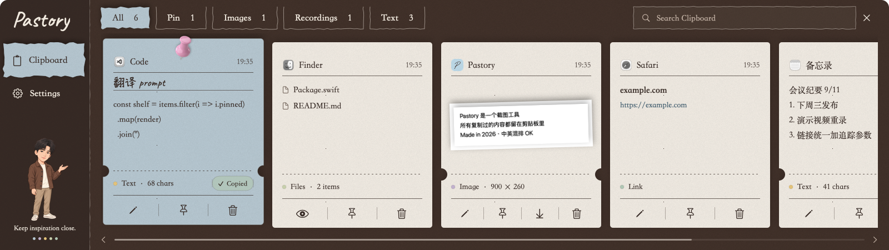

<p align="center"></p>
<h1 align="center">Pastory</h1>
<p align="center"><strong>A memory for your clipboard. A home for your inspiration.</strong></p>
<p align="center">Developed and maintained by Evinci · Native clipboard, capture and recording for macOS</p>
<p align="center"><a href="https://github.com/EEvinci/pastory/releases/latest">Download</a> · <a href="docs/ARCHITECTURE.md">Architecture explained (中文)</a> · <a href="README.md">简体中文</a></p>

<p align="center"></p>

The system clipboard remembers your last copy. Pastory keeps earlier text, links, images, files and recordings in searchable cards, ready to pin, edit and reuse.

Keep replies, prompts, addresses and reference screenshots together. Cocoa brown, mist blue, warm greige and Evinci's character give the workspace a personal stationery feel.

## Download and install

| Item | Details |
| --- | --- |
| Release | [v1.1.0 notes and assets](https://github.com/EEvinci/pastory/releases/tag/v1.1.0) |
| Package | [Pastory-1.1.0.zip](https://github.com/EEvinci/pastory/releases/download/v1.1.0/Pastory-1.1.0.zip) |
| System | macOS 15 or later |
| Architecture | One Universal package for Apple silicon and Intel |
| Signing | Ad-hoc signed; **not notarized by Apple** |

1. Download and unzip the package, then drag `Pastory.app` into Applications. Quit the old app before upgrading.
2. Open the app. Click its menu bar icon or press **⇧⌘V** to show the clipboard.
3. If macOS blocks it or cannot verify its developer, follow the included `FIRST-LAUNCH.txt` instructions and allow it in System Settings → Privacy & Security.
4. Grant **Screen Recording** permission when first using capture or recording, then relaunch when prompted.
5. Grant **Accessibility** permission for direct pasting into another app. Without it, click to copy and paste manually.

Pastory is a menu bar app. After onboarding it does not open a main window on every launch; check the menu bar if no window appears.

## Features

- Clipboard cards with titles, pinned favorites, editing and type filters.
- Keyword search across text, titles, source names and recognized image text.
- Click to copy; enable double-click pasting into the previous app in Settings.
- Screenshots with shapes, arrows, drawing, text and mosaic.
- On-device Chinese and English OCR.
- Region recording with MP4 and GIF export.
- Desktop notes: drag a card upward out of the shelf.
- Configurable retention; pinned items stay out of automatic cleanup.

| Action | Default shortcut |
| --- | --- |
| Show / hide clipboard | ⇧⌘V |
| Capture / record | ⌥⌘S |
| Search clipboard | ⌥⌘F |

All shortcuts can be changed in Settings.

## Local data

Core features run locally without an account, remote application server, cloud sync, update checks or clipboard uploads. OCR uses Apple Vision on the device.

History lives in `~/Library/Application Support/Pastory/`: a SQLite catalog, content files and thumbnails. Automatic cleanup is off by default and can be configured. Pinned items are retained. Collection stops while locked or paused; recognized password-manager sources and concealed/transient pasteboard types are skipped by default.

There is no additional app-level encryption. Quit the app before backing up the entire data directory. File cards retain paths to the original files; moving or deleting those files can break them.

## How it works


Pastory is written in Swift. AppKit manages windows, the menu bar and system interactions; SwiftUI renders cards and settings. SQLite stores metadata, while local files hold content. ScreenCaptureKit, AVFoundation and Vision provide screen capture, media and OCR capabilities.

Read the [plain-language architecture guide](docs/ARCHITECTURE.md) (Chinese) for examples and short product introductions.

## Current limits

- macOS 15+ only; no Windows, iPhone or cloud-sync version.
- No system or microphone audio in recordings; approximately 10 minutes per recording.
- Literal keyword search, not semantic search; only the first 200,000 characters of each text body are searched.
- Annotations are saved as flattened images, not editable element projects.
- Selections do not span displays. Avoid running multiple instances against the same history directory.

## Build from source

Requires a Swift 6 toolchain and Xcode / Command Line Tools with a macOS 15+ SDK. Running the app requires macOS 15+.

```bash
git clone https://github.com/EEvinci/pastory.git
cd pastory
./build.sh
open build/Pastory.app
```

For Xcode development, open **`Pastory.xcodeproj`**, select **Pastory → My Mac**, and press **⌘R**. This builds a complete `.app` with bundle metadata, fonts and character assets. Running the executable target in `Package.swift` directly does not perform the app packaging step.

```bash
./dist.sh                 # Universal ZIP, first-launch instructions and checksums
./release.sh notes.md     # Prepare local assets and notes; no automatic GitHub upload
```

Set your own `SIGN_ID` and `NOTARY_PROFILE` explicitly for Developer ID signing and notarization. See [DEVELOPMENT.md](docs/DEVELOPMENT.md) for conventions.

## Releases and licenses

[GitHub Releases](https://github.com/EEvinci/pastory/releases) contains packages, release notes and SHA-256 checksums. Updates are installed manually.

The initial source backup remains available at tag `backup/pre-style-2026-10-23`.

Licensed under [MIT](LICENSE). Open-source code, contribution and font notices are documented in [THIRD_PARTY_NOTICES.md](THIRD_PARTY_NOTICES.md) and included in the app.
