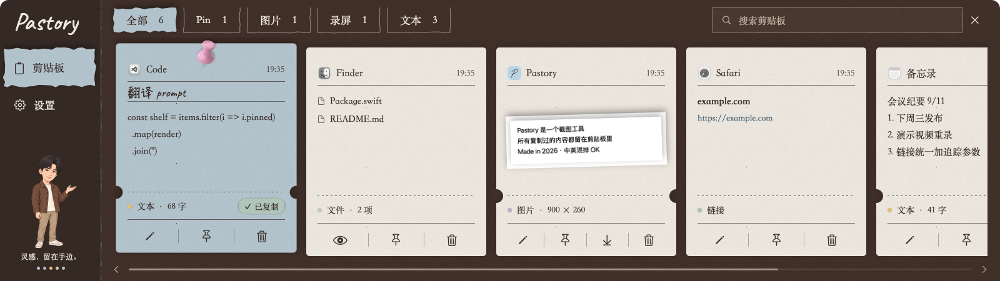

<p align="center"></p>
<h1 align="center">Pastory</h1>
<p align="center"><strong>让剪贴板有记忆，让灵感留在手边。</strong></p>
<p align="center">Evinci 开发与维护 · macOS 原生剪贴板、截图与录屏工具</p>
<p align="center"><a href="https://github.com/EEvinci/pastory/releases/latest">下载安装包</a> · <a href="docs/ARCHITECTURE.md">看懂软件架构</a> · <a href="README.en.md">English</a></p>

<p align="center"></p>

普通剪贴板只记得最后一次复制。Pastory 把之前复制的文字、链接、图片、文件和录屏整理成卡片，随时搜索、收藏、编辑和再次使用。

复制过的常用回复、Prompt、地址、参考截图，都可以在一个面板里找到。可可棕、雾霾蓝与米灰的纸感界面，搭配 Evinci 的人物 IP，让每天使用的工具也有自己的温度。

## 下载与安装

| 项目 | 说明 |
| --- | --- |
| 最新发布 | [v1.1.0 发布说明与下载](https://github.com/EEvinci/pastory/releases/tag/v1.1.0) |
| 安装包 | [Pastory-1.1.0.zip](https://github.com/EEvinci/pastory/releases/download/v1.1.0/Pastory-1.1.0.zip) |
| 系统 | macOS 15 或更新版本 |
| 处理器 | 同一个安装包支持 Apple 芯片与 Intel |
| 签名 | 本地 ad-hoc 签名，**未经 Apple 公证** |

1. 下载 ZIP 并解压，将 `Pastory.app` 拖入「应用程序」。升级时先退出旧版。
2. 打开应用。它常驻菜单栏；点击菜单栏的图标，或按 **⇧⌘V** 打开剪贴板面板。
3. 如系统提示无法验证开发者或阻止打开，按安装包内的 `FIRST-LAUNCH.txt`（首次打开说明），在「系统设置 → 隐私与安全性」中允许打开。
4. 第一次使用截图/录屏时授予**屏幕录制**权限，按提示重新启动应用。
5. 如需双击直接粘贴到其他应用，授予**辅助功能**权限。未授权时仍可单击复制，再自行粘贴。

应用完成欢迎引导后不会每次自动弹出窗口。“运行了但没有主窗口”时，先查看菜单栏。

## 可以做什么

| 场景 | 用法 |
| --- | --- |
| 保存常用文本与 Prompt | 复制后命名、Pin 收藏，下次搜索并复用 |
| 找回之前的内容 | 按类型筛选，搜索正文、标题、来源和图片识别文字 |
| 快速粘贴 | 单击卡片复制；开启对应设置后，双击直接粘贴到刚才的应用 |
| 截图与标注 | 框选或选择窗口，添加矩形、箭头、画笔、文字和马赛克 |
| 图片识字 | 在本机识别中英文文字，可复制结果并用于历史搜索 |
| 录屏与分享 | 区域录制后预览，保存为 MP4 或 GIF |
| 桌面便签 | 把卡片向上拖出面板，固定在桌面，继续编辑或复用 |
| 整理历史 | 修改保留时间、手动清理；Pin 内容不受自动清理影响 |

默认快捷键均可在设置中更改：

| 操作 | 默认快捷键 |
| --- | --- |
| 显示 / 隐藏剪贴板 | ⇧⌘V |
| 截图 / 录屏 | ⌥⌘S |
| 搜索剪贴板 | ⌥⌘F |

## 数据放在哪里

核心功能在本机完成：无需账号，没有远端业务服务器、云同步、在线更新检查或剪贴板上传。图片文字识别使用 Apple Vision 在设备上处理。

历史位于 `~/Library/Application Support/Pastory/`，包含 SQLite 目录索引、内容文件和缩略图。默认不自动清理历史，可在设置中调整；Pin 内容会长期保留。锁屏或手动暂停时不采集新内容，默认跳过能识别出的密码管理器来源及系统标记为隐藏/临时的内容。

本地存储没有额外的应用层加密。备份历史前先退出应用，再复制整个数据目录。文件卡片只引用原文件路径，移动或删除原文件后可能失效。

## 软件是怎样工作的

可以把它理解成“收件员 + 收纳柜 + 卡片展示台”：


这是 Swift 编写的原生 Mac 应用。AppKit 处理窗口、菜单栏与系统交互，SwiftUI 展示卡片和设置；SQLite 记录目录信息，本地文件保存实际内容。截图、录屏和识字分别使用 ScreenCaptureKit、AVFoundation 和 Vision。

**不懂代码也能读：** [Pastory 是怎样工作的](docs/ARCHITECTURE.md)，包含生活化解释、流程图，以及可以直接对外讲的 15 秒和 1 分钟介绍。

## 当前边界

- 只支持 macOS 15+，没有 Windows、iPhone 或云同步版本。
- 录屏暂不录系统声音和麦克风声音，单次时长上限约 10 分钟。
- 搜索是关键词匹配；单条正文最多前 20 万个字符参与搜索，不提供语义搜索。
- 标注完成后保存为合成图片，不保留可逐元素编辑的标注工程。
- 选区不跨显示器。不要同时运行多个实例并操作同一个历史目录。

## 从源码运行

需要 Swift 6 工具链和支持 macOS 15+ SDK 的 Xcode / Command Line Tools。运行时需要 macOS 15+。

```bash
git clone https://github.com/EEvinci/pastory.git
cd pastory
./build.sh
open build/Pastory.app
```

在 Xcode 中打开 **`Pastory.xcodeproj`**，选择 **Pastory → My Mac**，按 **⌘R**。它会生成包含真实应用标识、字体与人物素材的完整 `.app`。直接运行 `Package.swift` 的 executable target 不会执行 App 打包步骤，不作为日常界面调试入口。

```bash
./dist.sh                 # 生成 Intel + Apple 芯片通用包、首次打开说明与校验文件
./release.sh notes.md     # 在本地准备分发包并附发布说明，不自动上传 GitHub
```

正式签名与公证可显式配置自己的 `SIGN_ID`、`NOTARY_PROFILE`。开发约定见 [DEVELOPMENT.md](docs/DEVELOPMENT.md)。

## 版本与许可

[GitHub Releases](https://github.com/EEvinci/pastory/releases) 提供安装包、发布说明与 SHA-256 校验文件。升级通过手动下载替换应用完成。

最初源码备份保存在 `backup/pre-style-2026-10-23` 标签，后续发布不会覆盖该标签。

项目采用 [MIT License](LICENSE)。包含的开源代码、贡献和字体许可见 [THIRD_PARTY_NOTICES.md](THIRD_PARTY_NOTICES.md)，相关声明也随安装包提供。
