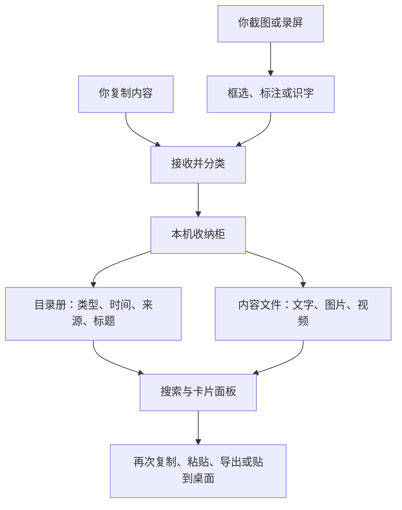

# Pastory 是怎样工作的

这份说明面向不写代码的人，也可以作为介绍产品时的讲稿。内容按当前源码核对。

## 一句话讲清楚

**Pastory 是一个在 Mac 本机工作的收纳助手：把复制过的东西收进卡片，需要时搜出来、点一下就能再次使用；截图、标注和录屏也放进同一个工作空间。**

普通剪贴板像一张随时被覆盖的便利贴，只保留最后一次复制。Pastory 在旁边准备了一个有目录的收纳柜，帮你保留之前的内容。

## 它由五个部分组成

| 部分 | 用日常生活来理解 | 实际负责什么 |
| --- | --- | --- |
| 入口与总协调 | 前台和开关 | 菜单栏、全局快捷键、设置、权限与启动流程 |
| 内容接收 | 收件员 | 发现新复制的文字、链接、图片或文件，识别类型并过滤不应记录的内容 |
| 存储与检索 | 收纳柜和目录册 | 保存原内容，记录时间、来源、标题和收藏状态，去重、搜索、清理 |
| 卡片界面 | 展示台 | 用卡片展示历史，提供复制、编辑、收藏、预览与桌面便签 |
| 截图与录屏 | 相机和加工台 | 取得屏幕画面、框选、标注、识字、录制并导出 |

它们都在**同一个 Mac 应用进程**里工作。这里的“存储部分”是本地代码，不是一台云端服务器。



## 复制一段文字，会经过哪些步骤

以“复制一段常用回复”为例：

1. **发现变化。** 应用每隔约半秒看一次系统剪贴板的变化计数；计数变了，才尝试读取内容。
2. **判断要不要收。** 暂停记录、锁屏时不采集；系统标记为隐藏或临时的内容会被跳过。默认也会跳过能识别出的密码管理器来源。
3. **给内容建档。** 记录内容类型、复制时间、来源应用等信息。已经存过的相同内容通常会前移，不再生成一张重复卡片。
4. **分别保存目录和正文。** 文字正文放入本地文件，标题、来源、收藏等信息放入本地数据库。
5. **界面自动刷新。** 卡片面板观察这些数据的变化，显示新卡片或调整顺序。
6. **再次使用。** 单击把内容写回系统剪贴板。开启直接粘贴且获得辅助功能权限后，双击还会收起面板，向刚才的应用发送一次粘贴操作。

应用写回剪贴板时会给条目加上自己的标记，避免“自己复制一次，又给自己新增一条”的循环。

## 为什么既要数据库，又要文件夹

把它想成图书馆：

- **数据库是目录册。** 告诉你有什么、什么时候收进来、来自哪里、是否 Pin 住，以及正文文件在哪。
- **文件夹是书架。** 放实际的文字、图片、录屏和缩略图。
- **内存是手边的工作台。** 缓存最近使用的缩略图和可搜索文字，让界面少重复读文件；退出后可重新建立缓存。

当前数据目录是 `~/Library/Application Support/Pastory/`：

```text
Pastory/
├── pastory.sqlite       目录：类型、时间、来源、标题、Pin 等
├── items/               正文、图片、视频和文件路径列表
├── thumbs/              用来快速显示卡片的缩略图
└── share/               录屏分享时使用的文件链接或副本
```

设置另存在 macOS 的偏好设置中。数据库采用 SQLite，可以理解成“嵌在软件里的小型目录册”，不需要安装或连接数据库服务器。

**文件条目保存的是原文件路径，不会把 Finder 中复制的所有文件再备份一份。** 移动或删除原文件后，这类卡片可能失效。截图、录屏等由应用保存的内容则有自己的本地文件。

备份数据时，先退出 Pastory，再复制整个数据目录；SQLite 可能还带有 `-wal`、`-shm` 伴随文件，不应只在运行中拷贝一个数据库文件。

## 搜索为什么不会每输入一个字就卡住

搜索工作放在独立的执行区域中，避免把大量文件读取和文字匹配挤到界面线程上。可以把它理解成“后台找资料的人”和“前台接待的人”分开做事。

- 输入稍微停顿约 80 毫秒再搜索，减少连续打字产生的重复工作。
- 已经读取的文字会缓存；内容、标题或识字结果改变时再更新。
- 新搜索来了，旧搜索可以取消；过期结果不会被用于粘贴。
- 目前是关键词的字面匹配，不是大模型语义搜索。单条正文只把前 20 万个字符纳入搜索缓存，标题、来源和 OCR 文字也参与匹配。

## 截图、标注和识字是什么关系

**截图是拍照，标注是加工，识字是读照片里的文字。**

1. 用户按快捷键，应用检查屏幕录制权限。
2. macOS 提供屏幕画面；应用先冻结当时的画面，再让用户框选或选择窗口。
3. 标注工具把箭头、方框、画笔、文字等保存在内存中的图形列表里，实时绘制预览。
4. 完成后，把原图和标注合成一张图片，保存到历史并写入剪贴板。
5. 图片里的文字由 Apple Vision 在设备上识别，结果可以复制，也能参与之后的历史搜索。

标注里的手绘感来自本地绘制算法：在线条上加入固定的小幅扰动。它不需要打开一个在线画图网站。

当前保存的是合成后的图片，不是保留每个箭头和文字框的可编辑设计工程。重新打开历史图片时，不能逐个选中当时已经合成进去的标注。

## 录屏为什么比截图复杂

截图只需要一帧；录屏需要把很多帧按正确的时间顺序写成视频。

```text
确认录制范围 → 开始接收画面帧 → 编码写入 MP4
→ 停止并完成写入 → 预览 → 保存 MP4 或转换为 GIF
→ 进入本地历史并复制结果
```

macOS 的 ScreenCaptureKit 负责提供画面，AVFoundation 负责视频写入和编码；Pastory 负责选区、录制状态、计时、控制条、异常处理、预览和保存。

当前目标帧率为 30 fps，录制时长上限约 10 分钟，**暂不录制系统声音和麦克风声音**。GIF 是录制后再转换出来的。

## 界面是怎样做出来的

这是 **Swift 写的 macOS 原生应用**：

| 技术 | 通俗解释 | 在这里的用途 |
| --- | --- | --- |
| AppKit | Mac 应用的窗口与系统交互工具箱 | 菜单栏、浮动面板、选区、鼠标键盘与焦点管理 |
| SwiftUI | 用数据描述界面的工具 | 卡片列表、设置、欢迎引导和桌面便签的内容展示 |
| SQLite + 本地文件 | 目录册 + 收纳柜 | 持久保存历史内容和元信息 |
| ScreenCaptureKit | 系统提供的屏幕取景器 | 获取截图和录屏画面 |
| Vision | 系统自带的识字工具 | 在本机识别图片文字 |
| AVFoundation | 系统媒体工具箱 | 视频编码、写入与预览，支持后续 GIF 转换 |

项目没有使用 Electron、网页前端或远端业务服务器。SwiftPM 配置没有声明第三方软件包依赖；字体及其他素材的许可另有说明。

## 为什么之前 Xcode 显示运行，却没有正常打开

源码、可执行程序和完整应用是三件事：

- **源码**是做软件的图纸。
- **可执行程序**是能够工作的核心机器。
- **`.app` 应用包**是把机器、身份信息、图标、字体和人物素材装在一起的完整产品。

直接运行 `Package.swift` 的 executable target，相当于把核心机器单独拿出来，系统未必读得到应用包里的身份和资源。日常 Xcode 调试应打开 `Pastory.xcodeproj`；`build.sh` 也会把命令行构建结果组装成完整的 `Pastory.app`。

软件是菜单栏工具，不是每次启动都弹出主窗口。欢迎引导完成后，可点击菜单栏图标或按 ⇧⌘V 打开卡片面板。

## 这个架构的取舍

- **适合现在：** 不需要维护服务器，核心功能离线工作，能直接使用 Mac 的截图、窗口和快捷键能力。
- **需要留意：** 本地目录不是应用额外加密的保险箱；别人获得该目录的访问权限，就可能读取内容。去重所用的哈希也不等于加密。
- **当前边界：** 只支持 macOS 15+；没有云同步、在线更新、语义搜索、录音或跨屏选区。
- **扩展代价：** 多设备同步要增加同步与冲突处理；Windows/iPhone 版要重新适配系统接口，不能只换一套界面。

## 可以直接对外讲的版本

**15 秒版**

> Pastory 是我开发和维护的 Mac 效率工具。它把复制、截图和录屏收进一个本地卡片空间，需要时搜出来就能再次使用，减少反复翻找和重复操作。

**1 分钟版**

> 可以把 Pastory 理解成电脑上的自动收纳助手。普通剪贴板只记得最后一次复制，它会把之前的文字、链接、图片和录屏整理成卡片，还能收藏、搜索、编辑和贴到桌面。它是原生 Mac 应用，使用系统提供的截图、视频和识字能力，历史内容保存在自己的电脑里，不需要账号或服务器。界面用棕色、雾霾蓝和米灰营造纸张与文具的感觉，让一个日常工具也带有我的个人风格。

## 想进一步看代码时

| 要理解的问题 | 对应源码 |
| --- | --- |
| 应用如何启动、挂在菜单栏 | [AppDelegate.swift](../Sources/Pastory/App/AppDelegate.swift) |
| 如何发现复制、过滤内容 | [ClipboardMonitor.swift](../Sources/Pastory/Clipboard/ClipboardMonitor.swift) |
| 如何去重和保存内容 | [ClipStore.swift](../Sources/Pastory/Clipboard/ClipStore.swift)、[ClipDB.swift](../Sources/Pastory/Clipboard/ClipDB.swift) |
| 如何搜索、更新卡片选择 | [ClipSearchIndex.swift](../Sources/Pastory/Clipboard/ClipSearchIndex.swift)、[ShelfPanel.swift](../Sources/Pastory/Shelf/ShelfPanel.swift) |
| 如何截图和组织选区 | [CaptureCoordinator.swift](../Sources/Pastory/Capture/CaptureCoordinator.swift) |
| 如何画标注 | [AnnotationRenderer.swift](../Sources/Pastory/Annotate/AnnotationRenderer.swift) |
| 如何识字和录屏 | [OCR.swift](../Sources/Pastory/Annotate/OCR.swift)、[ScreenRecorder.swift](../Sources/Pastory/Capture/ScreenRecorder.swift) |
| 如何实现桌面便签 | [DesktopNotes.swift](../Sources/Pastory/Shelf/DesktopNotes.swift) |
| 如何决定清理哪些内容 | [Retention.swift](../Sources/Pastory/Clipboard/Retention.swift) |

更细的开发约定见 [DEVELOPMENT.md](DEVELOPMENT.md)。软件包含的开源代码、字体与贡献说明见 [第三方说明](../THIRD_PARTY_NOTICES.md) 和 [LICENSE](../LICENSE)。
