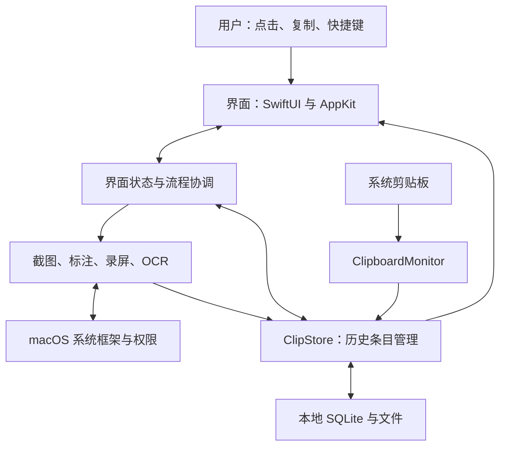

# Pastory 架构与机制说明

日期：2026-10-23。基于当前已移除在线更新的源码；本次是代码阅读与文档整理，没有变更应用功能，也没有运行真实屏幕采集。

## 1. Info.plist 中的应用标识是什么

`Resources/Info.plist` 中的 `CFBundleIdentifier=local.pastory.app` 是应用标识（Bundle ID），当前由我们手动设置，用于让系统区分应用。它不是向苹果申请下来的开发者身份，也不会让应用获得苹果认证。

| 概念 | 在这里的含义 |
|---|---|
| Bundle ID | 标识一个应用，例如当前的 `local.pastory.app` |
| Team ID | 苹果开发团队的标识，来自开发者团队和签名身份 |
| Developer ID 签名证书 | 用于证明站外发布包所属开发者/团队，并验证签名完整性 |

本地构建可自行选择应用标识；若以后走 App Store 分发，包内标识需要与 App Store Connect 中的应用配置匹配。参见 [Apple：CFBundleIdentifier](https://developer.apple.com/documentation/bundleresources/information-property-list/cfbundleidentifier)。

## 2. 这是一个怎样的应用

这是 macOS 15+ 的原生菜单栏应用。Swift 是主要开发语言，SwiftUI 与 AppKit 构建界面，系统框架提供屏幕采集、媒体编码、OCR 等能力，SQLite 和文件系统保存历史。

`Package.swift` 只有一个可执行 target，源码位于 `Sources/Pastory`。当前没有声明第三方包依赖，也没有独立服务器工程。

可以保留“界面和数据处理分别负责什么”的思路，但当前工程更适合按界面、状态与业务协调、系统能力、持久化来理解。文件后缀都是 Swift，只表示使用同一种语言，不表示职责相同。当前实现常用单例和观察状态；部分界面直接调用存储/控制器，不是严格隔离的前后端或严格 MVVM。



| 模块 | 主要文件 | 负责什么 |
|---|---|---|
| 应用生命周期 | [main.swift](../Sources/Pastory/App/main.swift)、[AppDelegate.swift](../Sources/Pastory/App/AppDelegate.swift) | 启动、菜单栏图标、菜单、快捷键绑定、启动各模块 |
| 窗口与交互状态 | [ShelfPanel.swift](../Sources/Pastory/Shelf/ShelfPanel.swift) | NSPanel、焦点、前台应用、键盘交互、ShelfModel |
| 页面与设计 | [ShelfView.swift](../Sources/Pastory/Shelf/ShelfView.swift)、[Theme.swift](../Sources/Pastory/App/Theme.swift) | 布局、颜色、字体、纹理、按钮和纸张形状 |
| 内容历史 | [ClipboardMonitor.swift](../Sources/Pastory/Clipboard/ClipboardMonitor.swift)、[ClipStore.swift](../Sources/Pastory/Clipboard/ClipStore.swift) | 检测复制、内容识别、去重、保存、复制回剪贴板 |
| 索引与搜索 | [ClipDB.swift](../Sources/Pastory/Clipboard/ClipDB.swift)、[ClipSearchIndex.swift](../Sources/Pastory/Clipboard/ClipSearchIndex.swift) | SQLite 元数据、搜索缓存与后台检索 |
| 截图与录屏 | [CaptureCoordinator.swift](../Sources/Pastory/Capture/CaptureCoordinator.swift)、[ScreenRecorder.swift](../Sources/Pastory/Capture/ScreenRecorder.swift) | 流程协调、取屏、选择区域、视频写入 |
| 标注与 OCR | [AnnotateView.swift](../Sources/Pastory/Annotate/AnnotateView.swift)、[AnnotationRenderer.swift](../Sources/Pastory/Annotate/AnnotationRenderer.swift)、[OCR.swift](../Sources/Pastory/Annotate/OCR.swift) | 图形交互、渲染、文字识别 |
| 导出与便签 | [Exporter.swift](../Sources/Pastory/Shelf/Exporter.swift)、[DesktopNotes.swift](../Sources/Pastory/Shelf/DesktopNotes.swift) | 保存文件、桌面窗口、位置和层级 |

## 3. 有风格的界面怎么形成

界面由三类东西共同组成：预先设计的图像/字体资源、代码规定的视觉规则、响应数据和操作的真实控件。没有发现把完整 HTML 页面嵌进 WKWebView 的实现。

### 固定素材

`Resources` 中的 Logo、应用图标、菜单栏图标、图钉 PNG 和字体文件随 App 打包。代码加载这些素材，并把它们放进各自的界面位置。菜单栏图标设为 template，让 macOS 根据菜单栏明暗着色。

历史卡片上的来源应用图标，则由 `Theme.cardIcon` 按应用 Bundle ID 向本机 `NSWorkspace` 查询并缓存；它不是向某个在线图标服务请求。

### 用代码表达设计规则

`Theme.swift` 集中定义深棕、米色、浅蓝、文字色、字体、描边、圆角和阴影。SwiftUI 视图和 AppKit 工具条共享这些视觉规则，保持一致。

源码中的例子：

```swift
Text("Pastory")
    .font(.script(42))
    .foregroundStyle(Color.onBrown)
```

这段代码分别指定显示文字、手写字体与字号、文字颜色；周围的 `HStack`、`VStack`、padding、frame 等规定布局。状态改变后，SwiftUI 会重新计算受影响的界面。

`Theme.noiseTile` 在内存中生成噪点纹理，`paperTile` / `deskTile` 把颜色与纹理预先合成并重复使用。`ShelfView.swift` 的 `TornPaper` 用带固定种子的扰动路径生成撕纸边缘，`PaperPatch` 再填充纹理并加阴影。这些效果由参数化绘制形成，不是整页固定图片。

### 真实交互和状态

`ShelfModel`、`ClipStore` 使用可观察状态；`ShelfView` 使用 `@Bindable` 和 `@State`。搜索内容、选中的卡片、Pin 状态、设置页面、语言等变化，会影响对应组件。一个截图无法承载这些真实交互。

所以后续设计可以分开做：更换图像素材、调整全局主题、改变组件布局或新增交互。只有新增功能通常才需要继续改存储或系统能力层。

## 4. 历史记录、本地文件和缓存

当前软件的历史是持久保存的数据，并非关闭就消失的临时缓存。

```text
~/Library/Application Support/Pastory/
├── pastory.sqlite       条目索引与元数据
├── items/               文字、图片、视频等内容文件
├── thumbs/              图片/视频缩略图
└── share/               用于粘贴文件的易读文件名
```

SQLite 保存条目 ID、类型、时间、来源应用、标题、Pin、OCR 文字、文件扩展名、内容哈希等。正文和较大的媒体内容单独放在文件里，避免把所有数据都塞进一个内存数组或数据库大字段。

| 条目 | 实际保存方式 |
|---|---|
| 文本、链接 | `.txt`；有富文本时另存 `.rtf` |
| 图片 | 按设置存 `.heic` 或 `.png` |
| 录屏 | `.mp4` 或 `.gif`，配缩略图 |
| Finder 中复制的文件 | `.json` 记录原文件路径，不等于自动备份原文件内容 |

真正可重建的缓存包括：内存中的缩略图和来源应用图标、`ClipSearchIndex` 缓存的归一化文本和搜索资料。SQLite 和 payload 文件是历史的主要数据来源，不能当临时缓存随便删。

当前没有发现云端数据库、账号同步、上传接口或 CloudKit 实现。已移除更新器后，也没有原仓库版本请求。OCR 使用本机 Vision 框架，未接入在线 OCR 服务。

这说明应用本身按当前代码在本机处理和保存内容；用户主动粘贴到聊天软件发送、另行使用云盘/系统备份，则是其他软件或用户选择的流程。这里的“本地”也不代表软件额外加密了所有文件，当前存储使用普通 SQLite 与内容文件。

只做本地通常减少了服务部署、账号认证、网络重试、多设备冲突等工作。但本地工具仍要处理大历史、磁盘满、文件丢失、重复条目、删除恢复和界面卡顿，复杂性并不会全部消失。

## 5. 从一次复制到一张卡片

```text
用户复制
→ NSPasteboard 的 changeCount 改变
→ ClipboardMonitor 检测变化
→ 判断文字/链接/图片/文件，过滤不该记录的类型
→ ClipStore 计算内容哈希、去重、写内容和索引
→ 生成缩略图，图片异步做 OCR
→ 可观察数据变化，界面出现或更新卡片
```

- 监听器每 0.5 秒检查一次变化计数，不是每次把完整剪贴板内容重复写入。
- 自己写回剪贴板的内容带私有 marker，再次检测时把已有条目前移，避免无限重复记录。
- 隐藏/瞬态类型及密码管理器来源有跳过规则；锁屏时暂停采集。
- `stableHash` 基于 SHA256 计算稳定内容标识，用于去重；这不等于加密内容。
- 搜索在独立 `actor` 中读取和归一化正文并复用缓存，界面侧有防抖、取消旧搜索和防止使用过期搜索结果的检查。
- `Retention` 负责按配置清理；Pin 条目不走普通到期删除，默认新设置为永不删除。
- 删除会记录 tombstone，避免再次导入时让已删除内容复活；数据库读写失败也有停止清理和提示机制。

## 6. 截图、系统 API 和权限

这里实际是 macOS 开发。可以把受保护能力理解为：应用调用公开系统 API，由系统检查用户是否允许，再向应用返回允许访问的数据。添加调用代码不会自动授予权限，也不必等到安装时立即申请；本项目在用户准备截图/录屏时检查。

```text
快捷键/菜单
→ CaptureCoordinator.start
→ Permissions.ensureScreenRecording
→ 系统允许后获取显示器/窗口信息与屏幕画面
→ SelectionOverlay 显示选区界面
→ 按屏幕缩放比例裁剪
→ 标注或切换到录屏
```

`Screenshotter` 使用 ScreenCaptureKit 的 `SCScreenshotManager.captureImage`，系统完成底层画面采集；项目负责选择目标、像素尺寸、颜色空间、光标策略、裁剪、浮层与焦点恢复等产品体验。还会在选择浮层出现前先冻结画面，保留当时展开的菜单。

权限由 `CGPreflightScreenCaptureAccess` 检查、`CGRequestScreenCaptureAccess` 请求。拒绝时功能不能继续，需要提示用户；当前应用还提供重新启动入口。辅助功能权限另用于模拟 ⌘V，和屏幕录制权限分别处理。

“通过系统 API 请求用户同意”是常规原生开发方式，但 macOS 与 iOS 的 API、沙箱和允许采集范围不同。iPhone/iPad 的录制应按 ReplayKit 等平台能力及用户确认流程设计，不能把当前 Mac 的窗口选择和全局快捷键逻辑原样搬过去。

官方参考：[macOS 屏幕采集示例](https://developer.apple.com/documentation/screencapturekit/capturing-screen-content-in-macos)、[iOS/iPadOS ReplayKit 安全机制](https://support.apple.com/guide/security/replaykit-security-seca5fc039dd/web)。

## 7. Excalidraw 风格标注怎么实现

当前是借鉴 Excalidraw 的视觉与部分交互，在 Swift 中实现项目需要的标注子集。证据是：`Package.swift` 没有引入 Excalidraw 包，标注代码直接使用 AppKit/Core Graphics，未发现嵌入 Excalidraw 网页或调用其网络接口。

| 部分 | 实现 |
|---|---|
| 工具和元素模型 | `Annotation.swift`：矩形、椭圆、箭头、直线、画笔、文字、马赛克；记录点、颜色、粗细、文字、边框尺寸和随机种子 |
| 鼠标与键盘交互 | `AnnotateView.swift`：按下、拖动、松开、命中选择、移动、缩放、编辑文字、删除和撤销 |
| 工具按钮 | `AnnotateToolbar.swift`：工具、颜色和尺寸选择 |
| 绘制 | `AnnotationRenderer.swift`：Core Graphics / NSBezierPath 绘制元素 |
| 文字排版 | `AnnotationTextView.swift`、`AnnotationTextLayout.swift`：文字编辑、换行和导出排版 |

手绘感的实现是：将几何路径打平成点列、增加平滑的小幅扰动、画两遍略不同的轮廓。元素保存固定种子，因此窗口重绘和最终导出时线条不会随机跳变。自由画笔用曲线平滑，马赛克通过缩小区域后无平滑放大来生成色块。

编辑时，原截图和 `annotations` 列表分别存在内存；完成时由 renderer 合成为一张最终图片，再交给历史存储和剪贴板。当前没有看到把整份标注列表保存成可重新逐元素编辑的工程格式，因此以后重新打开图片，不等于仍保有原来的每一个可编辑箭头。

这里也说明 API 的两种含义：调用 Core Graphics 属于调用本机系统框架 API，不涉及远程请求；它与调用一个网站的 HTTP API 是不同的连接方式。

## 8. 录屏：系统提供画面，应用组织成视频

```text
确认录制范围并按开始
→ RecordingSession 管理边框、控制条、计时和会话
→ ScreenRecorder 用 SCStream 接收画面帧和时间戳
→ AVAssetWriter 编码写入临时 MP4
→ 停止并完成文件写入
→ RecordingPreviewWindow 预览，选择 MP4 / GIF / 丢弃
→ 如选 GIF，由 GIFEncoder 转码
→ ClipStore 保存，复制结果到剪贴板
```

系统负责提供画面帧和媒体编码框架；项目还需正确处理开始/停止、时间戳、队列、帧尺寸、异常、窗口排除、输出文件和预览，这就是“小软件”里实际较复杂的一部分。

当前实现的具体边界：

- 目标帧率 30 fps，按显示器实际像素尺寸录制，尺寸整理为偶数以适应编码。
- MP4 使用 H.264 或 HEVC，可在设置中选择；MP4 是容器，H.264/HEVC 是内部编码方式。
- `capturesAudio=false`：当前不录系统声音，也不录麦克风；显示鼠标光标。
- `RecordingSession` 大约 10 分钟触发停止，定位于短操作演示。
- 录制边框和控制条会被排除；并非笼统排除本应用的全部窗口。
- 编码器跟不上时丢帧，避免阻塞采集队列；停止时还处理静止结尾的最后一帧时间。
- GIF 从 MP4 转换，按时长和大小预算调整帧率/分辨率；这不等同于保证输出永远小于某个严格上限。
- 当前没有在视频中实时叠加截图标注，也没有完整时间轴剪辑或暂停编辑工作流。

## 9. 格式、保存和分享如何联动

| 内容 | 内部保存 | 复制/导出 |
|---|---|---|
| 图片 | 默认 HEIC，可选 PNG | 手动导出 PNG；复制图片用 PNG/TIFF |
| 文字 | TXT，另可保留 RTF | 复制纯文本/富文本；导出 TXT |
| 视频 | MP4，H.264 或 HEVC | 复制文件到其他应用；导出 MP4 |
| 动图 | GIF | GIF 剪贴板数据/文件；导出 GIF |
| 原有文件 | 记录路径列表 | 复制引用或按用户选择复制到目标文件夹 |

HEIC 默认是有损存储；之后转成 PNG 不会恢复早先压缩损失的细节。若要求历史图像保留最初像素质量，应选择 PNG 存储。

`Exporter` 用系统保存/目录选择窗口让用户选位置。`PasteboardWriter` 根据内容类型写入系统剪贴板；视频用 `share/` 中易读名称的硬链接，无法硬链接则复制文件。这里的 share 是本地文件目录，不是分享服务器或公开链接。

当前没有发现自建云分享 API 或系统 NSSharingServicePicker。常用分享方式是先复制图片或文件，再由用户在微信、邮件等应用中粘贴发送；后续联网发送由接收内容的应用负责。

## 10. OCR、桌面便签及其他能力

- OCR：`Vision.VNRecognizeTextRequest` 识别中英文字，后台任务回写条目，使图片可以按文字搜索。
- 桌面便签：`DesktopNotes` 为同一条目建立独立 NSPanel，并在本地偏好里保存位置、尺寸和层级；不是重新复制一份独立笔记正文。
- 快捷键：`HotKeyCenter` 注册系统快捷键；输入焦点、原前台应用、关闭面板后粘贴需要控制器协调。
- 预览：Quick Look / 系统媒体能力配合项目窗口使用。
- 导入：读取其他工具的 SQLite 等支持格式，转换成统一条目，再交给同一存储层；不代表已经实现联网同步。

## 11. 为什么看起来小，实际功能不少

核心复用点是统一的 `ClipItem` 和 `ClipStore`：普通复制、截图完成、OCR 文字和录屏结果都进入同一套历史。卡片、搜索、Pin、便签、复制和导出再复用这些条目。因此各种功能能联动，不必为每种输入重建全部管理界面。

开发者主要承担两类工作：把系统现成能力组合成可靠流程，以及把视觉规范和交互细节落实到组件。苹果提供底层框架，不会自动提供这款软件的撕纸界面、选区调整、历史组织、格式选择和操作衔接。

后续加入自己的设计，优先改 Theme、Resources、Shelf 组件；增加云同步等能力会涉及数据、网络和冲突策略；增加声音、录制标注或剪辑则需要扩展媒体与交互流程，不能只换一套视觉素材。
